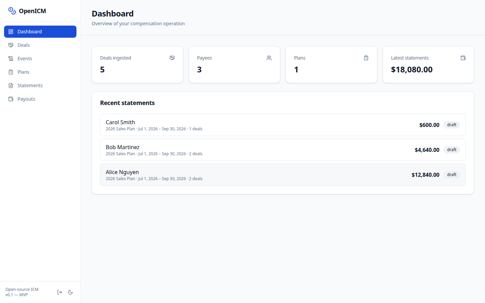
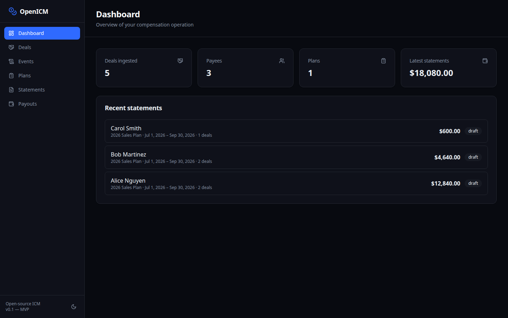
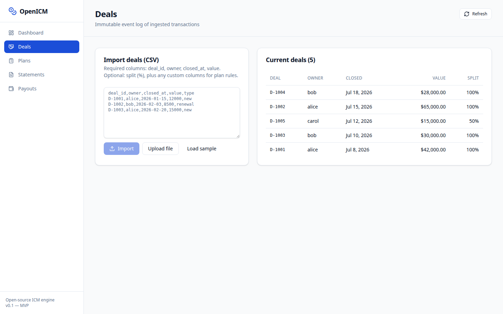
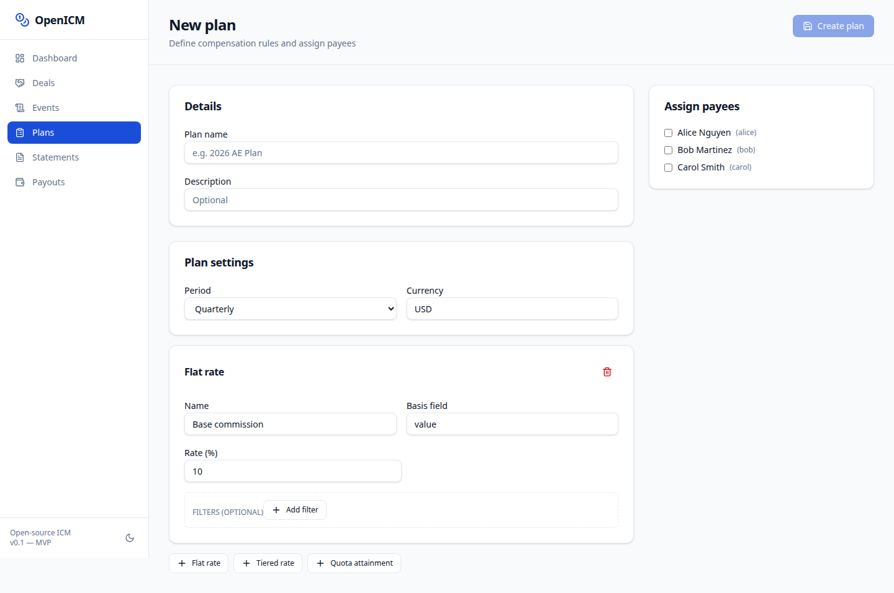
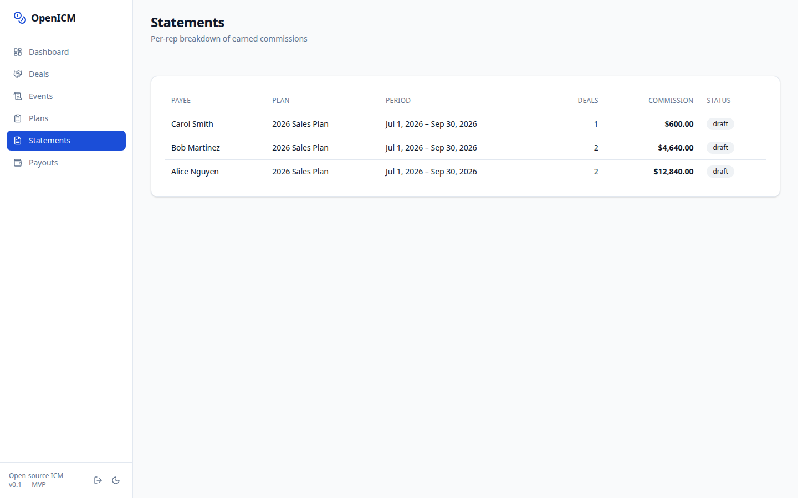
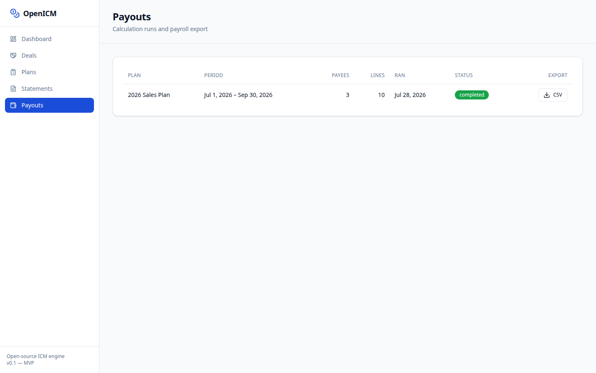
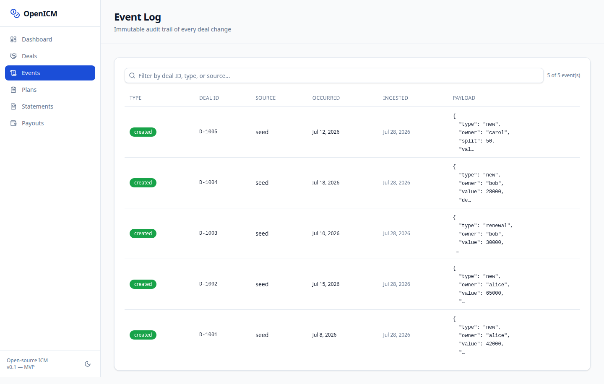
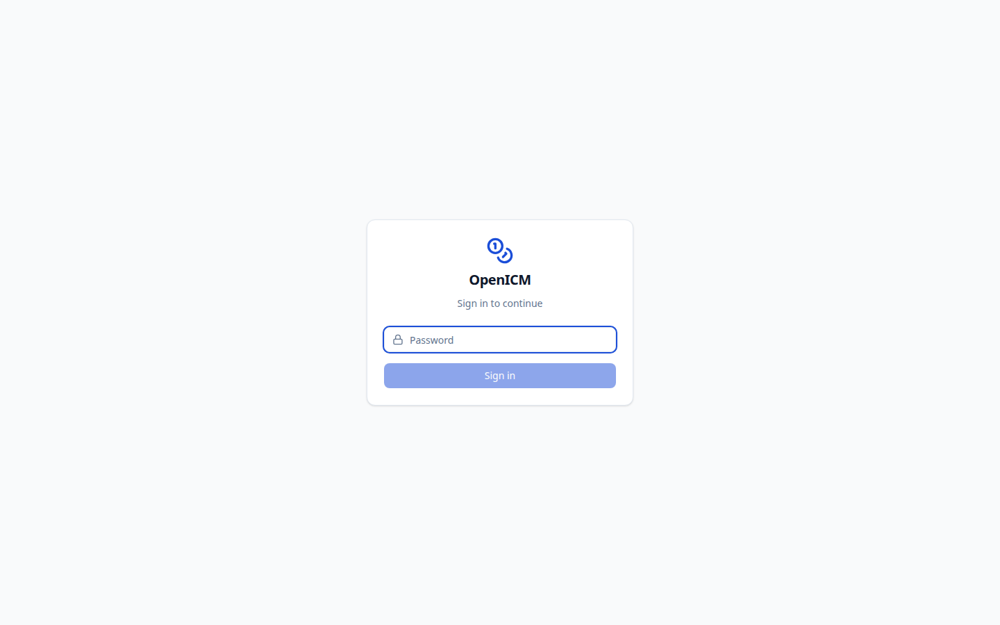

# OpenICM

**Open-source Incentive Compensation Management — a self-hostable alternative to CaptivateIQ, Xactly, and Spiff.**

<div align="center">

[](LICENSE)

[](https://github.com/okyssta/OpenICM/actions)
[](https://hub.docker.com/r/kysstaexe/openicm)
[](CONTRIBUTING.md)

**[✨ Live Demo](https://openicm.example.com) · [📖 Docs](SETUP.md) · [🐛 Report Bug](https://github.com/okyssta/OpenICM/issues) · [💬 Discussions](https://github.com/okyssta/OpenICM/discussions)**

</div>

---

Companies with variable pay — sales reps, partner programs, affiliates, recruiters — outgrow spreadsheets fast. Manual commission calc is error-prone, unauditable, and breaks the moment a plan has tiers, accelerators, clawbacks, splits, or retroactively-edited deals. **OpenICM is the first open-source system that solves this end-to-end.**

**Try it in 30 seconds:**

```bash
docker run --rm -p 3000:3000 ghcr.io/okyssta/openicm
# → http://localhost:3000 (sample data pre-loaded)
```

Or deploy instantly:

[](https://railway.app/template/openicm)
[](https://render.com/deploy?repo=https://github.com/okyssta/OpenICM)
[](https://zeabur.com/templates/openicm)

---

## Why This Exists

| Problem | Impact |
|---|---|
| No open-source ICM exists | Companies locked into $15k–$100k+/yr per-payee SaaS |
| Spreadsheets break at scale | Tiers, accelerators, clawbacks, splits cause errors |
| Retroactive deal edits corrupt payouts | Without event sourcing, past periods are irrecoverable |
| No audit trail | Reps can't see *why*, finance can't audit *what* |

Unlike CRM, billing, or support — which all have credible open-source incumbents (Chatwoot, Cal.com, Lago, Focalboard) — **commission/ICM had no serious open-source project until now.**

---

## Screenshots

<div align="center">








</div>

---

## Features

| Feature | Description |
|---|---|
| **CSV deal import** | Paste, upload, or reload sample data. Idempotent dedup. Auto-creates payees. |
| **Visual plan builder** | Flat rate, tiered (marginal/retroactive), quota attainment, draw/guarantee, clawback. Field filters. |
| **Multi-payee splits** | Co-owners via `co_owners` column — automatic deal expansion with pro-rata splits. |
| **Draw / Guarantee** | Minimum commission per period. Pro-rata shortfall distribution. |
| **Clawback** | Auto-reverse commission on churned/cancelled deals within configurable lookback. |
| **Event-sourced storage** | Append-only event log. Corrections are new events, never overwrites. |
| **Recompute-on-change** | Running a calculation always queries live events + current plan. Deterministic and idempotent. |
| **Rep statements** | Full per-deal, per-rule trace with basis, rate, amount, and detail. |
| **Dispute workflow** | Per-statement comment threads. Approve → paid status workflow. |
| **Payout export (CSV/GL)** | One-click download per run. GL-ready CSV with account codes for accounting integration. |
| **Plan simulation** | Preview "what-if" results without persisting. |
| **Plan versioning** | Every edit creates a new version. Calculations reference the specific version. |
| **Dark mode** | Toggle in sidebar. Persists to localStorage. Respects `prefers-color-scheme`. |
| **Event log / audit trail** | Raw event viewer with expandable JSON payload. |
| **Authentication** | Password-based login + API key auth (`X-Api-Key` header). Opt-in via `APP_PASSWORD`. |
| **RBAC** | Payee roles (admin/rep). Rep-scoped views via `X-User-External-Id` header. |
| **Webhooks** | Configurable endpoints with HMAC-SHA256 signatures. Auto-delivered on calculation complete. |
| **Rate limiting** | 200 req/min per IP. |
| **Public API** | Full OpenAPI 3.0 spec at `/api/openapi.json`. |
| **Helm chart** | Kubernetes deployment, service, and ingress included. |

All features ✅ complete and tested.

---

## Architecture

```
CRM / CSV → Ingestion → Immutable Event Log
                             │
                    Calculation Engine
                (query over events + active plan)
                             │
          ┌──────────────────┼──────────────────┐
          │                  │                  │
   Rep Statements      Dispute Workflow     Payout Export
   (transparency)      (approval + audit)   (GL/payroll)
```

**Key design principle:** Commissions are computed as a *deterministic query over an immutable event log*, not a mutable running total — the same approach usage-based billing engines use. Retroactive edits recompute cleanly, and every dollar traces to the exact rule + event that produced it.

The calculation engine [`src/engine/`](src/engine/) is a **pure TypeScript module with zero database dependencies** — fully unit-testable, deterministic, and embeddable anywhere.

---

## Quick Start

### Docker (recommended)

```bash
docker run --rm -p 3000:3000 ghcr.io/okyssta/openicm
# → http://localhost:3000 (sample data pre-loaded, auth disabled)
```

### Docker Compose

```bash
git clone https://github.com/okyssta/OpenICM.git
cd OpenICM
docker compose up --build -d
```

**First time?** See the [Setup Guide](SETUP.md) for production deployment with auth, custom domains, and SSL.

---

## Tech Stack

| Layer | Choice |
|---|---|
| Framework | [Next.js 15](https://nextjs.org/) (App Router) |
| Language | [TypeScript](https://www.typescriptlang.org/) |
| Database | [PostgreSQL](https://www.postgresql.org/) 16 |
| ORM | [Prisma](https://www.prisma.io/) 6 |
| Styling | [Tailwind CSS](https://tailwindcss.com/) 4 |
| Validation | [Zod](https://zod.dev/) |
| Testing | [Vitest](https://vitest.dev/) |
| CSV | [PapaParse](https://www.papaparse.com/) |
| Container | [Docker](https://www.docker.com/) + [Compose](https://docs.docker.com/compose/) |

---

## Repository Structure

```
src/
├── engine/          # Pure calculation engine (zero deps)
│   ├── calculator.ts
│   ├── reconstruct.ts
│   └── rules/       # flat-rate, tiered-rate, quota-attainment, clawback
├── app/
│   ├── api/         # Route handlers (18+ endpoints)
│   └── (dashboard)/ # UI pages (dashboard, deals, plans, statements, payouts)
├── components/
│   ├── ui/          # shadcn/ui primitives
│   └── plan-builder.tsx  # Visual rule composer
└── lib/             # DB client, CSV, calc orchestration, validation
helm/                # Kubernetes Helm chart
```

See [handoff.md](handoff.md) for the complete architecture, 10 ADRs, and file-by-file breakdown.

---

## Community & Support

- **Discussions** — feature requests, Q&A, show-and-tell
- **Issues** — bug reports, tracked and triaged
- **Contributing** — see [CONTRIBUTING.md](CONTRIBUTING.md)
- **Star this repo** ⭐ — it helps others find the project

---

## License

[AGPL-3.0](LICENSE) — Free to use, modify, and distribute. If you build a managed cloud service on top, you must contribute your modifications back.

---

<p align="center">
  <strong>⭐ Star us on GitHub — it helps people find this project ⭐</strong>
</p>
